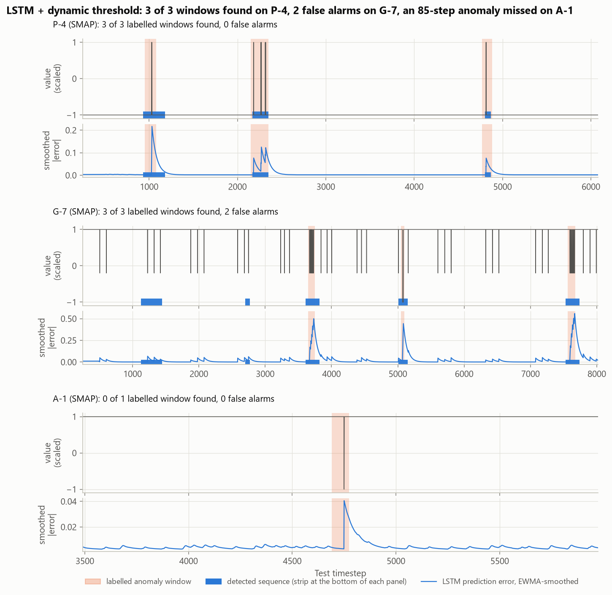
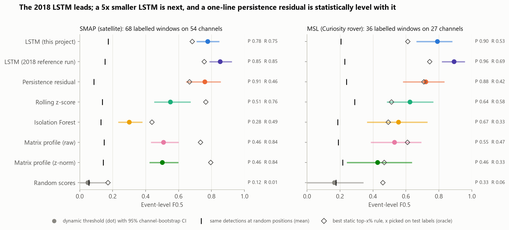
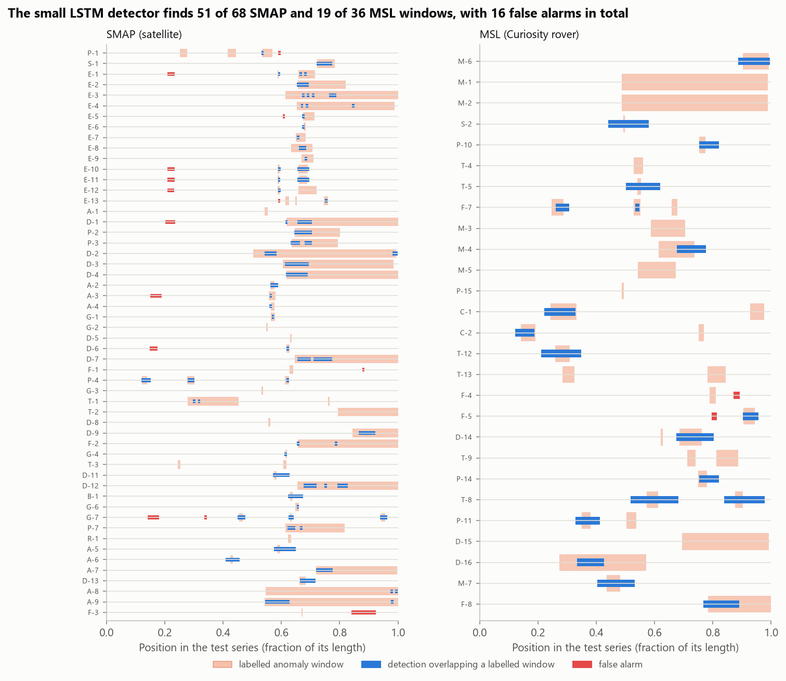
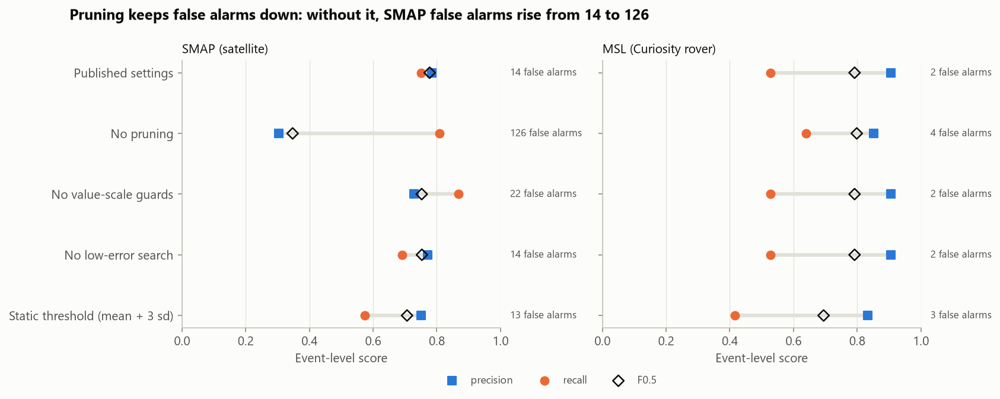
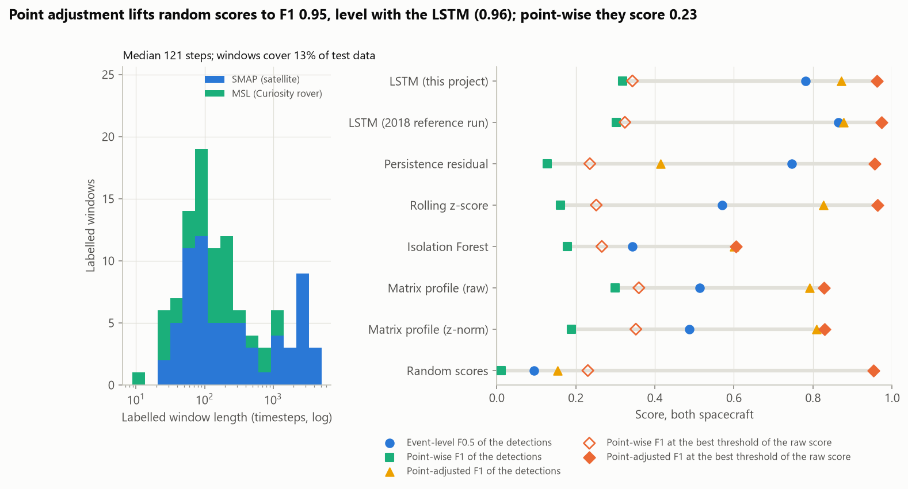
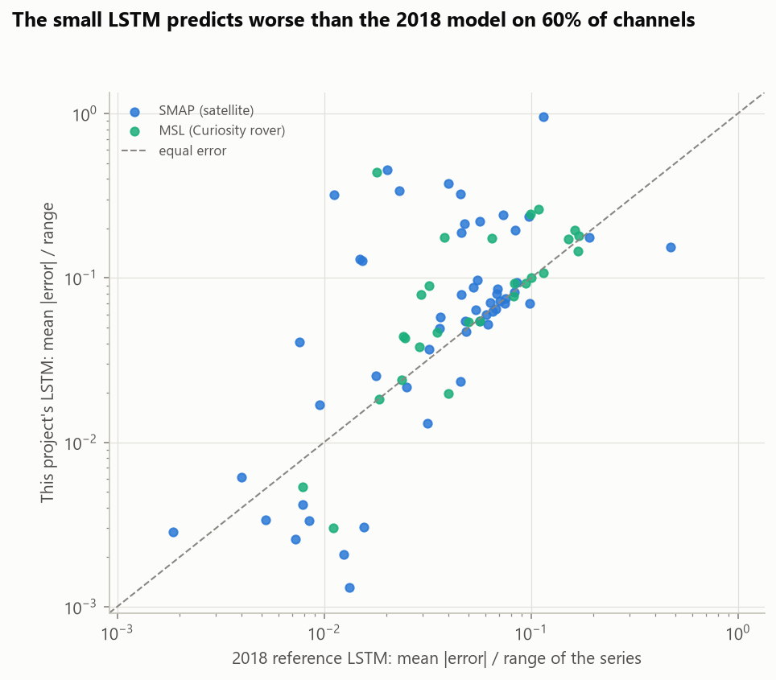

# Spacecraft Telemetry Anomaly Detection (NASA SMAP & MSL)

[](https://github.com/ChetanYarlagadda/spacecraft-telemetry-anomaly-detection/actions/workflows/ci.yml)

**Does an LSTM forecaster with nonparametric dynamic thresholding find spacecraft telemetry anomalies better than
simple baselines, and how much does the way detectors are scored change the answer?** This project reimplements the
detector NASA JPL published for this job (Hundman et al., KDD 2018), checks the reimplementation against the
authors' own reference run, and compares it with a persistence residual, a rolling z-score, Isolation Forest, matrix
profile and random scores on 81 labelled telemetry channels from the SMAP satellite and the Curiosity rover (MSL).

It mirrors the alerting work of any operations team that watches thousands of signals (spacecraft, fleets,
payments, infrastructure): the alarm budget is small, so results are reported as event-level precision, recall and
F0.5, which weights precision twice as much as recall. Every comparison gets a channel bootstrap and a paired test,
every detector is compared with a null that places its own detections at random, and the popular point-adjusted F1
is checked against pure noise.



## Key findings

| Detector (same dynamic thresholding for all) | SMAP F0.5 | MSL F0.5 | Both: F0.5 [95% CI] | Both: precision / recall |
|---|---:|---:|---:|---:|
| LSTM, 2018 reference run (2 × 80 units) | **0.853** | **0.893** | **0.865** [0.81, 0.92] | 0.883 / 0.798 |
| LSTM, this project (2 × 32 units, 5x fewer parameters) | 0.777 | 0.792 | 0.781 [0.72, 0.84] | 0.814 / 0.673 |
| Persistence residual \|y(t) − y(t−1)\| | 0.760 | 0.721 | 0.747 [0.66, 0.82] | 0.902 / 0.442 |
| Rolling z-score | 0.551 | 0.625 | 0.570 [0.49, 0.66] | 0.545 / 0.702 |
| Matrix profile (raw distance) | 0.509 | 0.531 | 0.514 [0.44, 0.60] | 0.481 / 0.712 |
| Isolation Forest | 0.301 | 0.556 | 0.343 [0.27, 0.42] | 0.326 / 0.433 |
| Random scores | 0.050 | 0.167 | 0.094 [0.00, 0.19] | 0.214 / 0.029 |

<sub>81 channels, 104 labelled windows (68 SMAP, 36 MSL). CI: 2,000 bootstrap resamples of channels. Full table
with the z-normalised matrix profile in [`event_results.csv`](reports/results/event_results.csv).</sub>

1. **The reimplementation is exact.** Re-thresholding the error series saved by the authors' 2018 reference run gives
   the same anomalous sequences on all 82 label rows (84 true positives, 11 false positives, 21 false negatives, as
   in the run's log). SMAP precision and recall (both 0.855) match the published numbers exactly; MSL recall (0.694)
   matches and precision is one false positive better than published (0.962 vs 0.926).
2. **LSTM + dynamic thresholding is the best combination tested, and model size matters.** The 2018 model leads on
   both spacecraft. The 5x smaller LSTM trained here in about 2 GPU-minutes trails it by 0.083 F0.5 pooled (95% CI
   [−0.150, −0.012], Holm p = 0.039); its prediction error is higher on 60% of channels.
3. **Much of the edge comes from the thresholding, not the forecaster.** A one-line persistence residual through the
   same detector is statistically level with the small LSTM (difference 0.035, CI [−0.053, 0.130]) and has the
   highest precision of all (0.90), at under half the recall. Under an oracle static rule (top x% of each channel,
   x picked on the test labels) the z-normalised matrix profile (0.795) and rolling z-score (0.766) beat both LSTMs
   on SMAP.
4. **Pruning is the component that controls false alarms.** Removing it from the detector raises SMAP false alarms
   from 14 to 126 and drops F0.5 from 0.777 to 0.347; a static mean + 3 sd threshold keeps precision but finds only
   52% of windows.
5. **Point-adjusted F1 cannot tell a detector from noise on this benchmark.** With the threshold picked on the test
   labels, uniform random scores reach a point-adjusted F1 of **0.954**, level with the small LSTM (0.962) and the
   2018 LSTM (0.973), because labelled windows are long (median 121 steps) and one lucky point marks a whole window
   as found. Event-level F0.5 puts the same random scores at 0.094.
6. **The benchmark files have quirks worth knowing.** Channel P-2 is listed twice with overlapping windows and the
   published counts include both rows; T-10 has data but no labels; 16 channels have a constant training value
   (Isolation Forest flags nothing on them); and 88% of SMAP windows start in the second half of their test series.

The data were checked against the published description first: the labels file is identical to the authors'
GitHub copy, and every count in the paper's dataset table (69 and 36 anomaly sequences, the point/contextual split,
55 and 27 channels, 429,735 and 66,709 evaluated values) is reproduced
([`data_crosscheck.csv`](reports/results/data_crosscheck.csv)).

## Results

### Reproducing the reference thresholding

The dataset archive ships the authors' 2018 reference run: LSTM predictions, smoothed errors and a log of true and
false positives per channel. The authors' repository also released that run's detected sequences. This project's
NumPy reimplementation of the thresholding, run on the saved errors, reproduces them
([`reference_reproduction.csv`](reports/results/reference_reproduction.csv)):

| Spacecraft | Label rows | Identical sequences | TP / FP / FN | Precision | Recall | Published precision / recall |
|---|---:|---:|---:|---:|---:|---:|
| SMAP | 55 | 55 | 59 / 10 / 10 | 0.855 | 0.855 | 0.855 / 0.855 |
| MSL | 27 | 27 | 25 / 1 / 11 | 0.962 | 0.694 | 0.926 / 0.694 |

<sub>The telemanom README also lists F0.5 = 0.71 (SMAP) and 0.69 (MSL); these cannot be derived from its own precision
and recall (F0.5 of P = R = 0.855 is 0.855), so only precision and recall are compared. This table follows the
82-row protocol of the reference run (P-2 counted twice); everything else uses 81 distinct channels.</sub>

### Event-level comparison



| Method | SMAP P | SMAP R | SMAP F0.5 | MSL P | MSL R | MSL F0.5 |
|---|---:|---:|---:|---:|---:|---:|
| LSTM (this project) | 0.785 | 0.750 | 0.777 | 0.905 | 0.528 | 0.792 |
| LSTM (2018 reference run) | 0.853 | 0.853 | 0.853 | 0.962 | 0.694 | 0.893 |
| Persistence residual | 0.912 | 0.456 | 0.760 | 0.882 | 0.417 | 0.721 |
| Rolling z-score | 0.515 | 0.765 | 0.551 | 0.636 | 0.583 | 0.625 |
| Isolation Forest | 0.275 | 0.485 | 0.301 | 0.667 | 0.333 | 0.556 |
| Matrix profile (raw) | 0.463 | 0.838 | 0.509 | 0.548 | 0.472 | 0.531 |
| Matrix profile (z-norm) | 0.456 | 0.838 | 0.502 | 0.462 | 0.333 | 0.429 |
| Random scores | 0.125 | 0.015 | 0.050 | 0.333 | 0.056 | 0.167 |

Paired channel-bootstrap tests of the small LSTM against each method, Holm-corrected within each spacecraft
([`significance.csv`](reports/results/significance.csv)): pooled over both spacecraft it beats the rolling z-score
(+0.211), both matrix profiles (+0.267, +0.294), Isolation Forest (+0.438) and random scores (all Holm p ≤ 0.004);
it is level with persistence (+0.035, p = 0.43) and behind the 2018 LSTM (−0.083, p = 0.039). Within one spacecraft
the gap to the 2018 LSTM is not significant (SMAP Holm p = 0.14, MSL 0.19), nor is the MSL gap to the rolling
z-score (p = 0.19).

Every method except random scores is far above its **random-placement null**, in which the same detected sequences are
moved to random positions in their channel: the null gives 0.14-0.18 pooled F0.5 (p = 0.001 for each method). Matrix
profile finds 84% of SMAP windows but raises 66 false alarms there. The 2018 LSTM finds 90% of *point* anomalies but
65% of *contextual* ones; the rolling z-score 85% and 49% ([`recall_by_class.csv`](reports/results/recall_by_class.csv)).



The examples at the top are chosen by rule: the channel with the most windows all found without a false alarm (P-4),
the channel with the most false alarms (G-7), and the first channel where nothing is found (A-1). On A-1 the 85-step
anomaly lifts the smoothed error to 0.04, just under the detector's absolute 0.05 floor, so the window is never
considered; without the value-scale guards it is found.

### Is it the score or the threshold?

Each score was also run through a simple static rule: flag the top x% of smoothed scores in every channel, buffer and
group them like the detector, and choose x (from 0.02% to 20%) to maximise F0.5 on the test labels. Choosing x on the
test labels makes this an oracle, an optimistic upper bound for any static threshold
([`oracle_static_threshold.csv`](reports/results/oracle_static_threshold.csv)):

| Score | Oracle static rule, SMAP F0.5 | MSL F0.5 | Both | Dynamic threshold, both |
|---|---:|---:|---:|---:|
| LSTM (2018 reference run) | 0.756 | **0.745** | **0.752** | **0.865** |
| Matrix profile (raw) | 0.733 | 0.610 | 0.692 | 0.514 |
| Matrix profile (z-norm) | **0.795** | 0.469 | 0.685 | 0.487 |
| Persistence residual | 0.667 | 0.709 | 0.676 | 0.747 |
| Rolling z-score | 0.766 | 0.513 | 0.673 | 0.570 |
| LSTM (this project) | 0.683 | 0.612 | 0.631 | 0.781 |
| Isolation Forest | 0.439 | 0.493 | 0.426 | 0.343 |
| Random scores | 0.172 | 0.461 | 0.220 | 0.094 |

The ranking depends on the thresholding. The dynamic threshold lifts the prediction-error scores well above any static
rule, even one tuned on the answers, but it suits the other scores worse than a simple top-x% rule does. A generic
score such as the z-normalised matrix profile is competitive on SMAP once its threshold is right.

### Which parts of the thresholding matter?



Same LSTM errors, one component removed at a time ([`ablation.csv`](reports/results/ablation.csv)):

| Variant | SMAP TP / FP | SMAP F0.5 | MSL TP / FP | MSL F0.5 |
|---|---:|---:|---:|---:|
| Published settings | 51 / 14 | **0.777** | 19 / 2 | 0.792 |
| No pruning | 55 / 126 | 0.347 | 23 / 4 | **0.799** |
| No value-scale guards | 59 / 22 | 0.753 | 19 / 2 | 0.792 |
| No low-error search | 47 / 14 | 0.753 | 19 / 2 | 0.792 |
| Static threshold (mean + 3 sd) | 39 / 13 | 0.707 | 15 / 3 | 0.694 |

### Why point-adjusted F1 inflates scores



Many deep-learning papers on SMAP and MSL report point-wise F1 after *point adjustment*: if any point inside a
labelled window is flagged, every point of that window counts as detected. Here the labelled windows cover 12.5% of
the test data and average about 600 steps, so a single flagged point inside a window is worth hundreds of true
positives ([`point_adjust.csv`](reports/results/point_adjust.csv)):

| Score (both spacecraft) | Point-wise F1, best threshold | Point-adjusted F1, best threshold | Event-level F0.5 (detector) |
|---|---:|---:|---:|
| LSTM (2018 reference run) | 0.324 | 0.973 | 0.865 |
| LSTM (this project) | 0.343 | 0.962 | 0.781 |
| Rolling z-score | 0.252 | 0.964 | 0.570 |
| Persistence residual | 0.235 | 0.956 | 0.747 |
| **Random scores** | 0.230 | **0.954** | 0.094 |
| Matrix profile (raw) | 0.360 | 0.828 | 0.514 |
| Isolation Forest | 0.266 | 0.606 | 0.343 |

<sub>"Best threshold" pools each spacecraft's channels after rank-normalising each channel's raw scores and picks the
single threshold with the best F1 on the test labels, the protocol behind many published SMAP/MSL tables.</sub>

Random noise gains 0.72 F1 from point adjustment and lands within 0.02 of the best detectors; it scores 0.230
point-wise, which is exactly the F1 of flagging every point. The same effect inflates real detector outputs: the
small LSTM's detections score 0.318 point-wise and 0.872 point-adjusted. Isolation Forest is the exception, partly
because its scores are all tied on the 16 channels with constant training data. Event-level precision and recall rank
random scores last, where they belong.

### The small LSTM



The small LSTM's mean absolute error, relative to each series' range, is higher than the 2018 model's on 49 of 81
channels (median 0.073 vs 0.048; [`channels.csv`](reports/results/channels.csv)). Part of the gap is early stopping:
on 29 channels the chronologically last 20% of training data, used for validation, is nearly constant (validation
MSE below 0.001), and on 24 channels training stopped after 5-6 epochs. Despite the higher error, its detections
reach F0.5 0.78-0.79, because the thresholding only needs errors to jump during anomalies.

## Data

| | |
|---|---|
| Source | NASA JPL telemetry anomaly benchmark released with Hundman et al., [*Detecting Spacecraft Anomalies Using LSTMs and Nonparametric Dynamic Thresholding*](https://arxiv.org/abs/1802.04431) (KDD 2018); labels from [`labeled_anomalies.csv`](https://github.com/khundman/telemanom/blob/master/labeled_anomalies.csv) in the authors' repository |
| Files | The original download link in the telemanom README (an S3 bucket) now returns 403, and the README points to a Kaggle copy that needs an API key. The arrays come from the Hugging Face mirror [`appleparan/telemanom`](https://huggingface.co/datasets/appleparan/telemanom) of the original `data.zip`, pinned to commit `2d22e10`; all 164 train/test files are checked against the SHA-256 the Hub records |
| Spacecraft | SMAP (Soil Moisture Active Passive satellite) and MSL (Mars Science Laboratory, the Curiosity rover) |
| Size | 82 label rows, 81 distinct labelled channels (54 SMAP, 27 MSL), 104 distinct anomaly windows; each channel has a train and a test series of one telemetry value plus 24 (SMAP) or 54 (MSL) one-hot command columns, scaled to [−1, 1] by the authors |
| License | BSD 3-Clause, Copyright (c) 2018 California Institute of Technology (the `LICENSE.txt` shipped with the data; the telemanom README says Apache-2.0) |

Channel ids are anonymised and timestamps removed by the authors. `P-2` appears twice in the labels file with
overlapping windows ([5300, 6420] and [5350, 6575]); here they are merged into one window. `T-10` has data but no
label row and is left out. The raw arrays (~175 MB) are downloaded to `data/raw/` and not redistributed here.

## Method

**Evaluated stretch.** Every method is scored on test timesteps 250 to n − 10 of each channel, the stretch the
reference system scored (it needs 250 steps of history and predicts 10 steps ahead). No labelled window starts
before timestep 290.

**Scores.**

| Method | Score at timestep t | Fitted on |
|---|---|---|
| LSTM (this project) | \|ŷ(t) − y(t)\|, ŷ the one-step forecast from the previous 100 steps of all columns (value + commands) | the channel's train series |
| LSTM (2018 reference run) | the same error from the original model (2 × 80 units, 250-step input), using the predictions shipped in the dataset archive | the authors' training run |
| Persistence residual | \|y(t) − y(t − 1)\| | nothing |
| Rolling z-score | \|y(t) − mean\| / max(sd, 0.01) over the previous 100 values | nothing |
| Isolation Forest | −score_samples of the window y(t − 99 .. t), 100 trees, 256 samples per tree | train windows |
| Matrix profile (raw / z-norm) | distance from the test subsequence ending at t (m = 100) to its nearest training subsequence (`stumpy.aamp` / `stumpy.stump`) | the channel's train series |
| Random scores | uniform noise | nothing |

The LSTM is one PyTorch model per channel: 2 layers of 32 units, dropout 0.2, a linear head predicting the next 10
values (MSE loss, Adam, learning rate 1e-3, batch 64), early stopping with patience 3 on the chronologically last 20%
of training windows, at most 20 epochs: 16,330 parameters for SMAP channels (25 inputs) and 20,170 for MSL (55
inputs), against about 86,000 and 96,000 for the 2018 model. The baselines' history length (100 steps) was fixed in
advance to match the LSTM's input.

**Nonparametric dynamic thresholding.** Errors are smoothed with an exponentially weighted moving average (span 105).
In windows of 2,100 values that advance 70 at a time, the threshold ε = μ + zσ uses the z in {2.5, 3, …, 11.5} that
maximises

    (Δμ/μ + Δσ/σ) / (|E_seq|² + |e_a|)

where Δμ and Δσ are the drops in mean and standard deviation when values above ε are removed, e_a are the anomalous
points (each buffered by ±100 steps) and E_seq the contiguous anomalous sequences. The same search runs on the errors
mirrored around their mean, so unusually low errors can also be flagged. Flagged sequences are then pruned: their
maxima, plus the largest unflagged error, are sorted in descending order, and every sequence after the last drop of
at least p = 13% is discarded. Value-scale guards skip windows and points whose errors are tiny relative to the
telemetry's own range (below 5% of its 5th-95th percentile range, or below 0.05 absolute). All parameters are the
published ones; the control flow follows the reference code, including its small quirks, which is why the reference
run is reproduced exactly.

Prediction errors (both LSTMs, persistence) go through the detector as is. The other scores sit on a large offset (an
Isolation Forest score near 0.5, a z-normalised matrix-profile distance near 6), and the pruning rule compares maxima
by relative drop, which assumes errors near zero in normal operation; on the raw scores it discards nearly every
detection. These scores are therefore first shifted by their own median over the previous 2,100 steps (causal) and
clipped at zero, and the value-scale guards, which are defined in telemetry units, are switched off for them. The
oracle static rule above shows how these scores do without this adaptation.

**Event-level metrics** (Hundman et al.). A labelled window is a true positive when any detected sequence overlaps
it; a detected sequence that overlaps no labelled window is a false positive. Precision = TP / (TP + FP), recall =
TP / (TP + FN), F0.5 = 1.25 · P · R / (0.25 · P + R).

**Statistics.** 95% confidence intervals resample channels (2,000 bootstrap draws, all methods on the same draws);
paired differences against the small LSTM are Holm-corrected within each spacecraft and pooled. The random-placement
null keeps every detected sequence's length and moves it to a uniformly random position in its channel (1,000 draws).

**Tracking.** Each method's metrics are logged as an MLflow run (local SQLite store in `mlruns/`, git-ignored);
summary tables are committed under [`reports/results/`](reports/results/).

## Validation and limitations

- **Small benchmark.** 104 labelled windows on 81 channels make every interval wide: the bootstrap CI of the small
  LSTM's pooled F0.5 spans 0.72-0.84. Rankings between neighbouring methods are mostly not significant.
- **Labels.** Windows were marked by the mission teams and include long ones (up to 4,218 steps), so "overlaps a
  window" is a generous criterion; 88% of SMAP and 67% of MSL windows start in the second half of the test series,
  a positional bias a detector could exploit. Telemetry values were scaled by the authors using test-set minima and
  maxima.
- **One LSTM configuration, trained once.** No hyperparameter search, one seed, a 100-step input instead of 250, and
  a chronological validation split that stops training early on flat channels. The 2018 model's predictions come
  from the archive; it was not retrained here.
- **Baseline settings.** One a priori history length (100 steps) and one adaptation of the detector (median shift,
  guards off) for scores that are not prediction errors. A detector tuned for each score could rank them differently,
  as the oracle static rule suggests.
- **A label-informed choice inherited from the reference.** The reference code skips flattening the first 250 smoothed
  errors on channel C-2 because its first anomaly is early. It is kept for every method to stay faithful to the
  published configuration.
- **Oracle numbers are upper bounds.** The best static rule and the best-threshold point-adjusted F1 are chosen on the
  test labels and only serve to separate score quality from threshold quality and to show the inflation.

## Reproduce

```bash
pip install torch --index-url https://download.pytorch.org/whl/cu128   # or the CPU build
pip install -r requirements.txt
python scripts/run_pipeline.py            # full run: downloads ~175 MB once; about 8 min on a laptop (RTX 4050, 2 CPU threads)
python scripts/run_pipeline.py --quick    # smoke test on 6 channels: outputs go to data/cache/smoke/
python scripts/make_figures.py            # redraw figures from reports/results/
pytest
```

LSTM predictions, matrix profiles and the other scores, and every set of detections are cached in `data/cache/`
under keys that include their settings and a hash of the data, so re-runs only recompute what changed. The full
run trains the 81 LSTMs in about 2 minutes on the GPU; the first matrix-profile call also spends about a minute
compiling stumpy's numba kernels.

## Project structure

```
telad/
  data.py          pinned download + SHA-256 check, label parsing, duplicate merge, check against the published statistics
  thresholding.py  nonparametric dynamic thresholding with pruning, static-threshold ablation
  lstm.py          per-channel PyTorch LSTM forecaster with early stopping, cached predictions
  baselines.py     persistence residual, rolling z-score, Isolation Forest, matrix profile (stumpy), random scores
  evaluation.py    running the detector, event-level tables, bootstrap, random-placement null, point adjustment, oracle rule
  metrics.py       event matching, F-beta, point adjustment, best-threshold F1, bootstrap, Holm
  tracking.py      MLflow logging
  figures.py       all report figures
  plotting.py      shared colorblind-safe styling
scripts/           run_pipeline.py (all experiments), make_figures.py
notebooks/         analysis.ipynb, the walkthrough with every table
reports/           figures/ and results/ (every number quoted above)
tests/             pytest suite (thresholding, metrics, scorers, LSTM, labels, reference reproduction)
```

## License

MIT; see [LICENSE](LICENSE). The SMAP/MSL data are Copyright (c) 2018 California Institute of Technology under the
BSD 3-Clause license and are not redistributed here. Hundman, K., Constantinou, V., Laporte, C., Colwell, I. and
Soderstrom, T. (2018). Detecting Spacecraft Anomalies Using LSTMs and Nonparametric Dynamic Thresholding. KDD '18.
